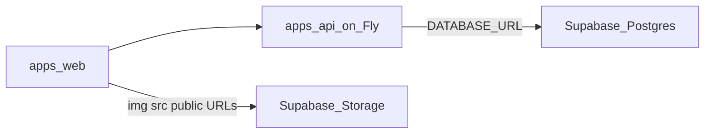

# Phase A: API on Fly, Postgres stays on Supabase (for now)

## Decisions locked in
- **Cost:** Skip Fly Managed Postgres Basic ($38/mo) until the product justifies it. Supabase Postgres has no free Fly equivalent.
- **Scope:** New stack ([`apps/api`](apps/api), [`apps/web`](apps/web)) reads catalog data through your API using `DATABASE_URL` → **current Supabase Postgres**.
- **Auth + Storage stay on Supabase** (same as before).
- **Images:** keep existing Supabase Storage public URLs.
- **Auth features deferred:** login, favorites, write reviews, merchant portal, admin.
- **Lovable production untouched.**

## Target architecture (now)



## Why this still leaves an exit ramp

`apps/web` talks only to `apps/api`. `apps/api` talks only to Postgres via `DATABASE_URL`. Supabase Auth/Storage stay as separate services.

When you outgrow Supabase, you move pieces independently — you do **not** rewrite the product:

| Piece | When you outgrow it | What you do |
|---|---|---|
| **Postgres** | Size, perf, pricing, region, ops needs | Provision Fly MPG / Neon / RDS / Cloud SQL → `pg_dump`/`restore` (or replicate) → change `DATABASE_URL` on Fly → redeploy |
| **Storage** | Bandwidth, CDN, cost | Sync buckets to Tigris/S3/R2 → rewrite `logo_url` / media URLs (or proxy) |
| **Auth** | Features, lock-in, compliance | Migrate users to Clerk/Auth.js/Fly-side auth (hardest part; do last) |

**Postgres move is the easy win** once you’re paying for a better host anyway — same SQL, same schema, secret swap. Auth/Storage are the sticky Supabase-specific parts.

## What happens when you’re “big enough”

Typical sequence (not all at once):

1. **Keep building** on Supabase Postgres until free/paid Supabase limits or ops needs push you.
2. **Stand up Fly MPG** (or another Postgres) when $38+/mo is fine relative to revenue/traffic.
3. **One-time data copy** of public (and later full) schema into the new DB; dual-run briefly if needed.
4. **Flip `DATABASE_URL`** on `sipmunchyap`; API/web keep working.
5. **Later:** move Storage, then Auth, when those become the bottleneck.

Until step 4, there is **no Fly DB cluster to create**.

## Implementation steps (Phase A)

### 1. Point the API at Supabase Postgres
- In Supabase: Project Settings → Database → connection string (prefer **pooled** URI for the Fly app; direct for local migrations/dumps if needed).
- Local: `DATABASE_URL` in `apps/api/.env` (gitignored).
- Fly: `fly secrets set DATABASE_URL=... -a sipmunchyap`.
- Restrict: use a least-privilege DB role for the API if practical; never commit the URI.

### 2. Wire [`apps/api`](apps/api)
- Add a Postgres client (`pg` or similar).
- Read endpoints (public catalog only):
  - `GET /health`
  - `GET /merchants`
  - `GET /merchants/:slug`
  - `GET /carousels`
- No Auth middleware in Phase A.

### 3. Wire [`apps/web`](apps/web)
- Keep `NEXT_PUBLIC_API_URL`.
- Call API; render image URLs returned from DB (still Supabase Storage).
- No Supabase JS client unless you add login/uploads later.

### 4. Verify
- Local web → local or Fly API → Supabase Postgres → merchants + images load.
- Lovable app still uses Supabase as today.

## Deferred: moving off Supabase Postgres
When ready to pay for Fly MPG (or another host):

```bash
fly mpg create --name sipmunchyap-db --region iad --plan basic
# dump from Supabase, restore into MPG, then:
fly mpg attach <CLUSTER_ID> -a sipmunchyap
# or manually set DATABASE_URL to the new host
```

At that point reuse the earlier dump/restore notes: trimmed DDL if needed, strip `auth.users` FKs for any tables you copy without Auth, keep Storage URLs until Storage moves.

## Out of scope (Phase B+)
- Paying for / provisioning Fly MPG now
- Migrating Auth users / OAuth
- Moving Storage buckets
- Porting edge functions
- Favorites, write reviews, merchant portal, admin on the new stack

## Main risks
- Fly app must reach Supabase over the public DB URL (IPv6/network and connection pooling matter; use pooler).
- Schema still evolves in Lovable/Supabase — API queries should tolerate additive changes or be versioned carefully.
- Hardcoded Supabase storage URLs remain until Storage is migrated.
